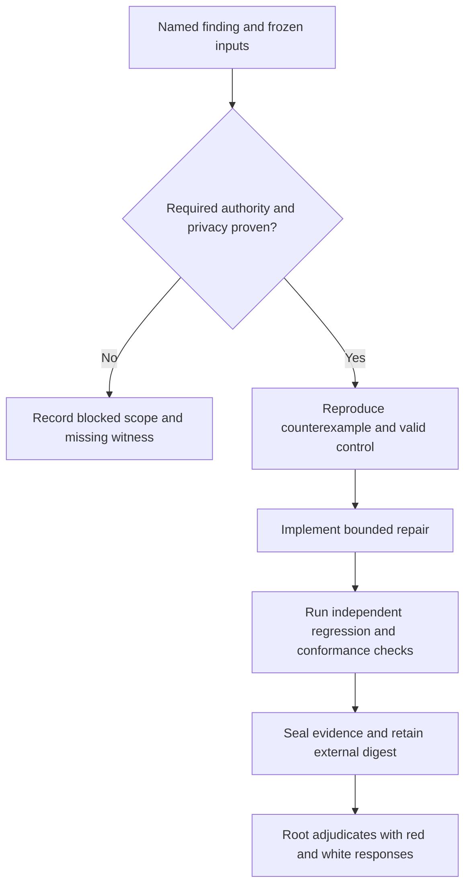

# Blue Team Research

Turn a defended claim into a bounded implementation and an independently
replayable regression. Red finds counterexamples; white answers the mathematics
and assumptions; blue repairs code and checks conformance; the root adjudicator
accepts, rejects, or defers each finding. Blue cannot close its own finding.

## Authority and privacy first

Obey the active worktree and runtime-halt orders. Work only in the assigned linked
worktree and feature branch; state owned files before edits. Do not invoke old
red/white scripts that spawn Port Daddy agents. Use the harness's ordinary offline
process mode only for commands whose complete argument vector and executable
behavior the caller has reviewed. `--reviewed` records that assertion; it is not
authenticated approval or permission to execute hostile code.

A separate directory, worktree, agent name, or process does not provide team
privacy. The bundled runner labels execution `host-reviewed-process`, sets
`privacy_enforced=false`, and supplies no signature. It provides neither network
isolation nor a hostile-code sandbox. It does not impose a hard disk/output quota
or contain a descendant that escapes its process group. If a round requires
private team compartments, root must provision and independently verify the
external access boundary before admitting those workloads. Until then record
`BLOCKED_PRIVACY`, preserve visible planning records, and run only approved
synthetic fixtures without secrets. No automatic installs, providers, daemons,
agent launches, or network access are part of this workflow.

## Round procedure

1. Bind the finding ID, exact source/model/policy versions, owned edit surface,
   and proof scope. Distinguish a finite model result, an implementation test,
   and an observed deployed behavior. List omitted routes and trusted adapters.
2. Preregister acceptance, rejection, and nonvacuity cases. Include a valid
   accepted example, an invalid rejected example, and evidence that the relevant
   reachable transition actually occurred. Zero explored states, zero assertions,
   unavailable tools, and missing terminal receipts cannot pass.
3. Preserve the original failing probe. Repair the smallest authorized surface;
   keep the negative control and require an independent oracle where practical.
   If the claim itself fails, return it to white and root instead of weakening the
   test to protect the statement.
4. Record commands, stdout, stderr, results, public decisions, changed artifacts,
   and short reasoning summaries. Never request or retain hidden chain of thought,
   credentials, personal data, or secret-bearing command arguments. “Full logs”
   means the complete visible execution transcript within the declared scope.
5. Inventory privacy denial probes before claiming isolation: cross-team reads,
   writes, shared caches, sockets, inherited credentials, and outbound channels.
   Use synthetic markers and independently observed allow/deny outcomes. A
   successful cross-team read disproves that privacy claim; directory names and
   declared policies cannot overrule the observation. The host fixture suite
   intentionally demonstrates such a read and never promotes it to privacy PASS.
6. Freeze all declared inputs before running; seal the final evidence inventory.
   Retain the returned seal digest outside the mutable archive, then verify it
   at handoff. Sealing a timeout or failed test preserves evidence; it does not
   turn the result into acceptance. Hashes establish consistency with an anchor,
   not authorship, secrecy, completeness of input selection, or mathematical truth.
7. Hand root the finding, repair diff, exact commands, counts, failed/successful
   controls, residual assumptions, archive location, and externally retained
   seal digest. Root supplies the final acceptance/rejection/defer decision.

## Offline evidence interface

Use [the runner](../../scripts/harbor-research/war_room.py) for an explicitly
reviewed offline command, and [its contract tests](../../scripts/harbor-research/test_war_room.py)
when changing logging or execution semantics. Run from the assigned worktree.
All campaign directories, source inputs, cwd, and test scratch belong under
`~/coding/tmp/`. The runner uses one campaign lock and per-team JSONL chains;
concurrent writers serialize. Input files remain pinned by path and digest and
must remain available for later verification. A partially written archive fails
closed and needs adjudicated recovery in a new campaign, not silent log repair.

Resolve RUNNER to the absolute path of the linked runner above.
The CLI is `python3 -B RUNNER --campaign ABS_PATH`:

| Subcommand | Contract |
|---|---|
| `record-event --team TEAM --kind KIND --data JSON` | Append a visible JSON event; teams are red, white, blue, root. |
| `freeze INPUT...` | Pin nonempty input inventory, including model, tests, helpers, and policy selected by the caller. |
| `run --team blue --cwd ABS_PATH --timeout 30 --reviewed -- ABS_EXECUTABLE ARG...` | Execute an argument vector without a shell; save separate stdout/stderr, exit status, timing, executable and output hashes. |
| `seal` | Commit complete event chains and output inventory; return the external digest to retain. |
| `verify --expected-seal SHA256` | Verify file hashes, checkpoints, chains, terminal receipts, and the supplied external anchor. |

Environment inheritance is reduced to an explicit minimal environment; that is
not protection against reading files available to the host identity. Same-user
coordinated rewriting can replace unanchored logs and manifests. Verification
without an independently retained expected seal checks internal consistency only.
The caller owns command review, dependency completeness, disclosure, and retention.

## Anti-patterns

**A repaired implementation certifies a theorem.** Novice: green tests close the
proof gap. Expert: tests establish the named finite cases; white must defend the
lemma and root must accept the exact scope. Detection: proof claims cite only a
zero exit code. This role split applies to the restored 2026-11 research rounds.

**Private folders become private teams.** Novice: team paths are isolated.
Expert: test the actual access boundary with synthetic denial probes, record the
external witness, and block privacy-dependent execution if it is absent.
Detection: privacy PASS has no observed denial or only a same-UID path convention.

**A seal becomes a signature.** Novice: a SHA-256 manifest proves who ran it.
Expert: retain an independent digest anchor and describe only byte consistency;
identity and witness independence require separately provisioned mechanisms.
Detection: `signature=null` receipts are presented as signed or authenticated.

## Activation checks

Apply this skill to: implement a red counterexample regression; repair a defended
checker; test finite-model conformance; seal a blue-team repair handoff; reproduce
a finding with valid and invalid controls.

Do not apply it to: adjudicate a theorem alone; launch hostile code on this host;
provision secret team compartments; respond to a production incident; start an
autonomous agent fleet. Route those tasks to their separately authorized owners.
